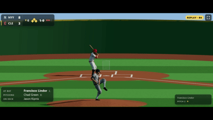
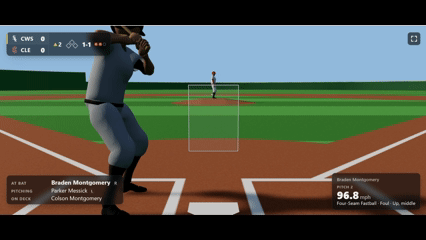
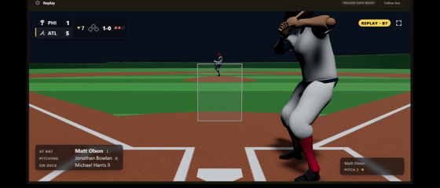
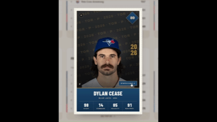
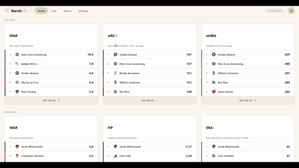
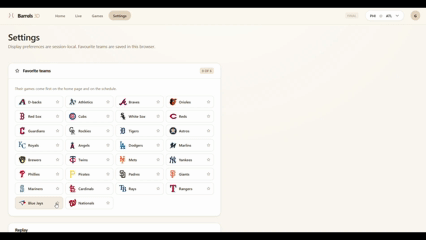
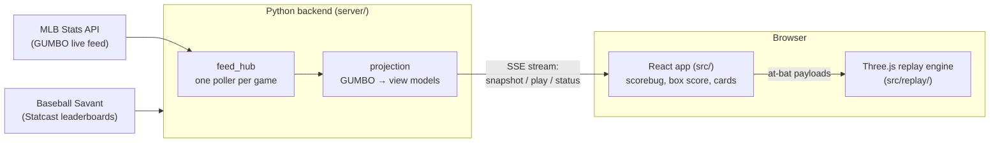

# Barrels 3D

**Every MLB at-bat, rebuilt in three dimensions: live, pitch by pitch.**

> **Work in progress.** This is an early public snapshot. The live companion
> and the 3D replay work end to end. Fielders, runners and plenty of polish are
> still to come. See [Status](#status).



## What it is

A box score tells you *that* a ball was hit 104 mph to right field. Barrels 3D shows you the play.

MLB publishes tracking data for every pitch of every game: where the ball was
released, how fast it was going, where it crossed the plate, and for balls in
play the exit velocity, launch angle and where the ball landed. Barrels 3D takes
that data as the game happens and turns each pitch into a short 3D replay. It
has a batter and a pitcher, the real ballpark's dimensions, and a broadcast-style
camera. Around the replay sits a full game companion: scorebug, box score,
at-bat feed, player cards and league leaders.

The goal is a second screen for watching baseball that shows what the numbers
actually looked like, not just the numbers.

## Tour

### Follow a game pitch by pitch



Pick a game and the replay follows it. Each new pitch plays in 3D as the feed
reports it. The scorebug, count, runners and at-bat list stay in step
with what's on screen.

### Two broadcast cameras, day or night



Watch from behind the plate or from the centre-field TV camera. A night game
gets a dark sky and stadium lights. You can also force day or night for every
game in Settings.

### Player cards



Click any player's name to open their card. The front has percentile ability
ratings; flip it for bio, season line, Statcast numbers and pitch arsenal.

### League leaders



The home page shows today's games and sabermetric leaderboards (WAR, wRC+,
wOBA, FIP, ERA-). Each board opens to a full top 50.

### Favourite teams and dark mode



Follow your clubs so their games come first. Dark mode is a warm espresso
palette, and team logos switch to versions drawn for dark backgrounds.

## Features

**3D replay**
- The pitch flies on a path fit to its tracked release point and its exact
  plate crossing.
- Batted balls are reconstructed from exit velocity, launch angle and spray,
  and simulated with drag, lift, bounce and roll. They land where MLB recorded
  them.
- An animated batter and pitcher. The swing is timed so contact happens where
  the ball actually is, and left-handed hitters are mirrored.
- A camera director that works the play like a broadcast: the catcher's view
  through contact, then a high camera that follows and zooms with the ball.
  There's also a centre-field broadcast shot, and free roam to watch from
  anywhere in the park.
- Every park's own outfield wall distances and heights.
- Pre-game, between-innings and final screens, taken from the game's own
  state.
- Highlights play every play of the game in order, from the first inning to
  now. Joined late? They catch you up, then switch back to following live.
- Pick any earlier play and the on-screen score box goes back in time with
  it: the score, count, outs and runners as they stood before that pitch,
  updating as the play lands.
- Contact sounds picked by how well the ball was hit: a barrel, a solid hit,
  or a mishit.

**Game companion**
- Live games streamed pitch by pitch from MLB's live game feed.
- Scorebug with the count, outs and runners, plus the line score, box score,
  at-bat feed and a 2D strike-zone plot.
- Any past date can be browsed, and *replay mode* re-runs a finished game as if
  it were live.
- Flippable player cards: ability ratings, season line, Statcast numbers and
  pitch arsenal.
- League leaderboards: WAR, wRC+, wOBA, FIP, ERA-, xBA, sprint speed and more.
- Favourite teams, plus light and dark themes.

## How it works



1. **Backend (`server/`).** A small Python server built on the standard
   library's HTTP server, with `requests` as its only dependency. It polls the
   MLB Stats API live feed for each game being watched, every 8 seconds while
   the game is live. It turns the raw feed into compact view models and streams
   them to the browser over Server-Sent Events. It also serves the
   leaderboards and player cards, joining MLB stats with Baseball Savant's
   Statcast boards.
2. **Frontend (`src/`).** A React app (Vite) renders the live state: scorebug,
   box score, at-bat list and player cards. Without the backend it falls back
   to built-in demo data, so the UI always runs.
3. **Replay engine (`src/replay/`).** A plain Three.js module with no React
   inside. The app hands it each at-bat. The engine fits the pitch path,
   solves the batted-ball flight, and puts both on a single clock with the
   batter and pitcher animations, so release, contact and landing all line up.
4. **Characters (`assets/animations/player_build.blend`).** One rigged
   character with seven animation clips and a modelled uniform, exported as
   `public/models/player.glb`. Team colours and jersey numbers are applied at
   runtime.

The detailed engineering notes live in
**[docs/ENGINEERING.md](docs/ENGINEERING.md)**. They cover the physics, the
camera director, how the swing is timed to the ball, the park walls, the
uniforms, the player-card ratings and the data quirks found along the way.

## Run it locally

You need Node 18+, Python 3.10+ and [Git LFS](https://git-lfs.com). The 3D
models are stored with LFS, so install it before cloning, or the player model
arrives as a small placeholder file and the characters won't load:

```bash
git lfs install
```

```bash
git clone https://github.com/ethanalder0/Barrels-3D.git
```

Start the backend:

```bash
pip install -r server/requirements.txt
```

```bash
python server/app.py
```

Then the frontend, in a second terminal:

```bash
npm install
```

```bash
npm run dev
```

Open http://localhost:5173. Vite forwards `/api` to the backend on port 8787.

**No live game on?** Use replay mode to re-run a finished game as though it
were happening now:

```
http://localhost:5173/?replay=1&speed=12&gamePk=822940&date=2026-08-16
```

`speed` sets how fast the recorded feed is replayed; 12 gets through a whole
game in a couple of minutes. The frontend also runs without the backend, using
demo data (the header says "Demo data").

**While watching:** <kbd>F</kbd> toggles full screen and <kbd>Space</kbd>
pauses or replays the play on screen. <kbd>L</kbd> (or the camera button on the
replay) cycles the camera: home plate → broadcast → free roam.

**In free roam:** <kbd>W</kbd><kbd>A</kbd><kbd>S</kbd><kbd>D</kbd> or the
arrow keys move, click and drag to look around, <kbd>Space</kbd> goes up and
<kbd>Shift</kbd>+<kbd>Space</kbd> down, and the scroll wheel zooms.
<kbd>B</kbd> turns to the ball and keeps following it from where you are, until
you drag or press <kbd>B</kbd> again.

**Highlights:** the **Highlights** button on Action Replay plays every play in
its list, oldest first. In a game that is still going it switches back to
following live after the newest one; in a finished game it stops on the last
play. Picking a play, pressing **Follow live** or **Stop** ends it early.

**Offline checks.** The replay engine:

```bash
npm run selftest
```

```bash
npm run selftest:parks
```

```bash
npm run selftest:follow
```

And the backend:

```bash
python server/selftest.py
```

```bash
python server/ratingstest.py
```

```bash
python server/situationtest.py
```

## Status

What works today:
- Live and past games, streamed or replayed, end to end.
- The 3D replay of every pitch and ball in play, with an animated batter and
  pitcher, in every park.
- Player cards, leaderboards and favourite teams.

Not done yet:
- **No fielders or runners.** Only the batter and pitcher are on the field.
- No glove yet. The cloth follows the body but doesn't swing or wrinkle.
- Sign-in is a placeholder, and settings other than favourite teams aren't
  saved.
- The playback controls under the replay are laid out but not wired up.

## Project layout

```
server/            Python backend: MLB feed polling, SSE, leaders, player cards
src/               React app
  screens/           home, live game, game list, leaderboards, settings
  components/        scorebug, replay viewport, player cards, box score…
  replay/            Three.js replay engine: field, pitch, ball, players, cameras
public/            static assets served as-is (player model, fonts, audio)
assets/            source assets (Blender build file, park and colour data)
scripts/           asset build scripts (parks, team assets)
docs/              engineering notes, and the GIFs in this README
field.html         the replay lab: the engine on its own, with test at-bats
```

## Credits

- **Data:** [MLB Stats API](https://statsapi.mlb.com) and
  [Baseball Savant](https://baseballsavant.mlb.com).
- **Character and animations:** [Mixamo](https://www.mixamo.com) (Adobe),
  rigged and outfitted in Blender. They are included only in built form
  (`public/models/player.glb` and `player_build.blend`). The raw Mixamo FBX
  downloads aren't in this repository, because Adobe's terms don't allow
  sharing them on their own.
- **Typefaces:** [Archivo](https://fonts.google.com/specimen/Archivo) and
  [Barlow Condensed](https://fonts.google.com/specimen/Barlow+Condensed), both
  under the SIL Open Font License.
- **3D:** [Three.js](https://threejs.org). **UI:** [React](https://react.dev) and
  [Vite](https://vite.dev).

## Disclaimer

Barrels 3D is an independent, non-commercial fan project. It is **not
affiliated with, endorsed by, or sponsored by Major League Baseball**, MLB
Advanced Media, or any MLB club.

MLB, team names, team logos, and broadcast audio clips are the trademarks or
copyrighted material of their owners. They appear here only to identify the
teams and games being shown. Game data comes from MLB Advanced Media and is
subject to [its terms of use](http://gdx.mlb.com/components/copyright.txt). It
is used here for personal, non-commercial purposes.

## License

The source code is released under the [MIT License](LICENSE). The license
covers this project's own code and original assets only. It does not cover the
third-party material listed under [Credits](#credits) and
[Disclaimer](#disclaimer), which stays under its owners' terms.
